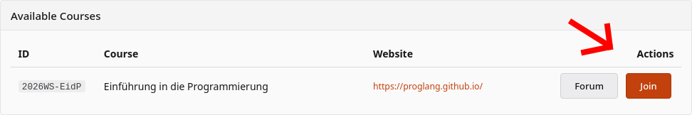
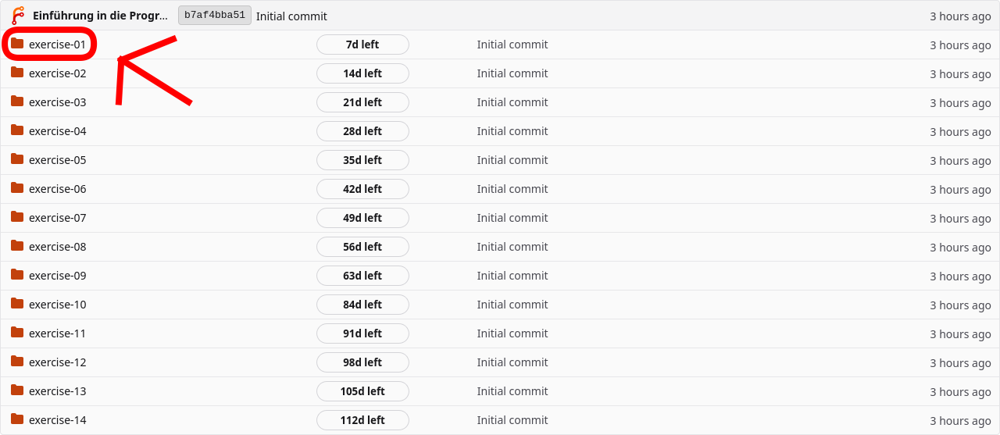
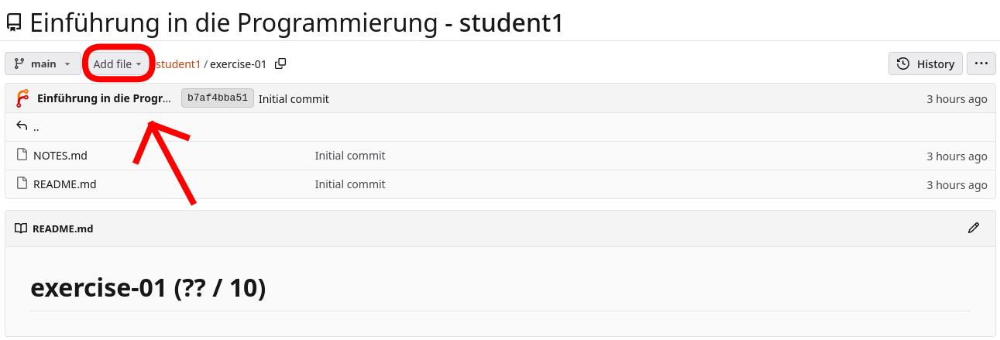
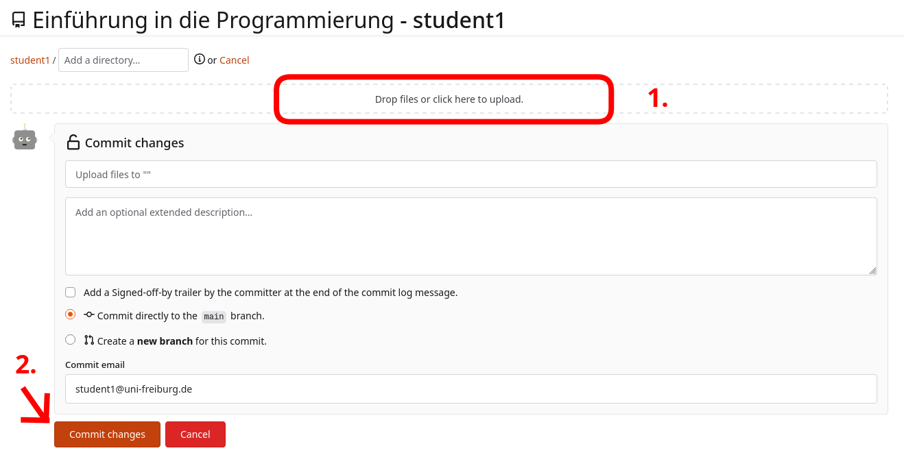
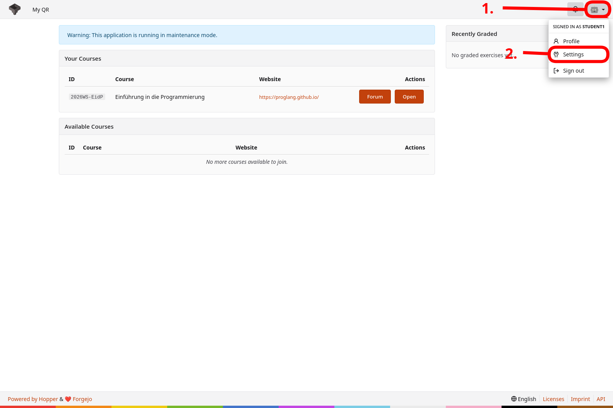
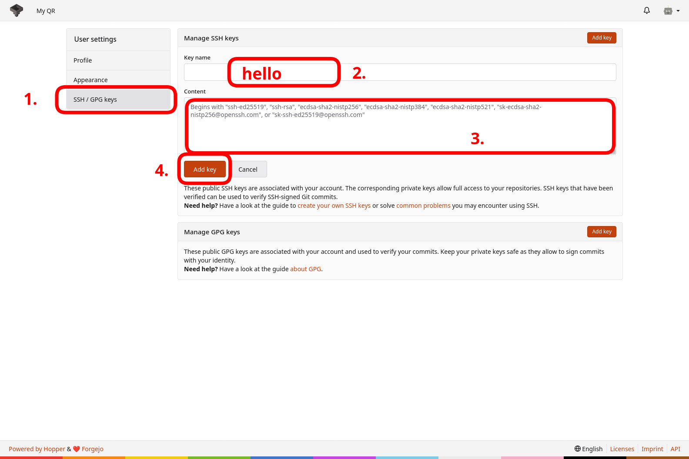
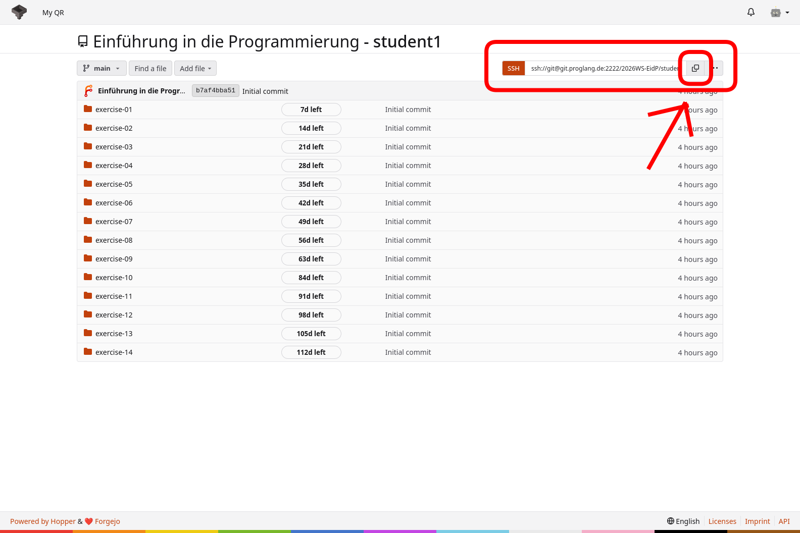
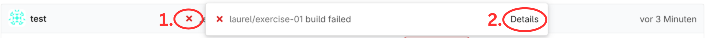

# Abgabesystem: Einführung in die Programmierung

Diese Anleitung beschreibt, wie Sie dem Kurs **2026WS-EidP Einführung in die Programmierung** beitreten und Ihre Lösungen einreichen. Sie können Ihre Abgaben direkt über die Website oder über Git hochladen; beide Wege werden im Folgenden Schritt für Schritt erklärt.

## Kurs beitreten

1. Öffnen Sie die Website des [Abgabesystems](https://git.proglang.de/).
2. Klicken Sie oben rechts auf **Anmelden / Sign in**.
3. Melden Sie sich mit Ihrem Uni-Account an.
4. Treten Sie dem Kurs **2026WS-EidP Einführung in die Programmierung** bei, indem Sie auf **Beitreten / Join** klicken.

    

## Abgabe

Sie können Ihre Lösungen auf zwei Wegen einreichen:

- direkt über die [Website](#über-die-website-abgeben) oder
- (empfohlen) über [Git](#über-git-abgeben).

### Über die Website abgeben

1. Öffnen Sie die Website des [Abgabesystems](https://git.proglang.de/) und melden Sie sich mit Ihrem Uni-Account an.
2. Öffnen Sie den Kurs **2026WS-EidP Einführung in die Programmierung**.
3. Navigieren Sie zu dem Ordner, in dem Sie Ihre Lösung abgeben möchten (zum Beispiel `exercise-01`).

    

4. Klicken Sie oben links auf **Datei hinzufügen / Add file** und wählen Sie **Datei hochladen / Upload file**.

    

5. Ziehen Sie Ihre Dateien per Drag-and-drop in das Ablagefeld (**1.**) oder klicken Sie es an und wählen Sie die gewünschten Dateien aus. Klicken Sie anschließend unten links auf **Änderungen committen / Commit changes** (**2.**), um die Dateien abzugeben.

    

6. Nach der Abgabe sehen Sie Ihre Dateien in der Übersicht. Achten Sie auf den grünen Haken rechts neben der Commit-Nachricht: Er zeigt an, dass der Build-Server Ihre Abgabe erfolgreich geprüft hat. Weitere Informationen dazu finden Sie unter [Build-Server](#build-server).

### Über Git abgeben

Die Abgabe über Git erfordert eine einmalige Einrichtung, ist danach aber bequemer: Sie laden Ihre Lösungen dann direkt aus Visual Studio Code hoch. Wenn Sie Python und VS Code noch nicht eingerichtet haben, folgen Sie zuerst dem [Setup Guide](../setup/setup.md).

#### Git einrichten

1. Öffnen Sie **Visual Studio Code (VS Code)**.
2. Öffnen Sie ein Terminal in VS Code (`` Ctrl + Shift + ` `` oder über `Terminal → New Terminal`).
3. Installieren Sie Git und SSH:

    ```bash
    # Linux & WSL:
    sudo apt install git ssh -y

    # Mac:
    brew install git openssh
    ```

4. Erzeugen Sie ein SSH-Schlüsselpaar:

    ```bash
    ssh-keygen -t ed25519
    ```

5. Drücken Sie **Enter**, um die vorgeschlagenen Standardpfade zu übernehmen. Der private Schlüssel wird unter `~/.ssh/id_ed25519` gespeichert, der öffentliche unter `~/.ssh/id_ed25519.pub`.
6. Geben Sie Ihren öffentlichen Schlüssel aus:

    ```bash
    cat ~/.ssh/id_ed25519.pub
    ```

    Die Ausgabe sieht etwa so aus:

    ```
    ssh-ed25519 AAAAB3NzMC+iS[...]wBlhd3n9VPCG0p= user@system
    ```

    Kopieren Sie den gesamten Text. Die Tastenkombination unterscheidet sich je nach Betriebssystem, ein Rechtsklick und **Kopieren / Copy** funktioniert aber immer.

7. Öffnen Sie das [Abgabesystem](https://git.proglang.de/) und melden Sie sich an.
8. Klicken Sie oben rechts auf Ihr Profilbild (**1.**) und wählen Sie **Einstellungen / Settings** (**2.**).

    

9. Öffnen Sie links **SSH- / GPG-Schlüssel** bzw. **SSH / GPG keys** (**1.**).
10. Vergeben Sie im Abschnitt **SSH-Schlüssel verwalten / Manage SSH keys** bei **Schlüsselname / Key name** eine Bezeichnung (**2.**) und fügen Sie den kopierten Schlüssel unter **Inhalt / Content** ein (**3.**).
11. Klicken Sie auf **Schlüssel hinzufügen / Add key** (**4.**).

    

12. Gehen Sie zurück zu Ihrem Repository (über die Startseite und den Kurs).
13. Kopieren Sie den SSH-Link Ihres Repositories über den **Kopieren / Copy**-Button oben rechts.

    

14. Wechseln Sie zurück in VS Code und navigieren Sie im Terminal zu dem Ordner, in dem Sie das Repository speichern möchten.

    Die wichtigsten Befehle:
    - `ls`: listet den Inhalt des aktuellen Verzeichnisses auf
    - `cd dirXYZ`: wechselt in das Verzeichnis `dirXYZ`
    - `cd ..`: wechselt eine Ebene nach oben

15. Klonen Sie Ihr Repository (ersetzen Sie `<ssh-url>` durch die kopierte Adresse):

    ```bash
    git clone <ssh-url>
    ```

    Danach sollte ein neues Verzeichnis mit Ihrem Kürzel erscheinen. Das ist Ihr lokales Repository.
16. Hinterlegen Sie in Git Ihren Namen und Ihre E-Mail-Adresse:

    ```bash
    git config user.name "Ihr Name"
    git config user.email "ihre@mail.de"
    git config pull.rebase true
    ```

#### Workflow mit Git

Führen Sie alle folgenden Befehle im Terminal im Verzeichnis Ihres Repositories aus.

1. **Lokalen Stand aktualisieren**

    Prüfen Sie mit `git status`, ob lokale Änderungen vorliegen. Falls ja, committen Sie diese zuerst:

    ```bash
    git add <dateiname>
    git commit -m "Nachricht"
    ```

    Laden Sie anschließend den aktuellen Stand vom Server:

    ```bash
    git pull
    ```

2. **Änderungen hochladen**

    ```bash
    git add <dateiname>
    git commit -m "Nachricht"
    git pull
    git push
    ```

#### Merkhilfe: Git-Workflow

```bash
git pull
# ... Dateien bearbeiten ...
git add <dateien>
git commit -m "Nachricht"
git pull
git push
```

Merken Sie sich die Reihenfolge: zuerst `git pull`, dann Dateien bearbeiten, dann `git add`, `git commit`, `git pull` und `git push`. Damit kann eigentlich nichts schiefgehen.

## Build-Server

Nachdem Sie Ihre Lösung hochgeladen haben, überprüft der Build-Server automatisch, ob Ihr Code den vorgegebenen Stilrichtlinien (zum Beispiel *flake8*) entspricht und ob Sie in der Datei **NOTES.md** Ihre aufgewendete Bearbeitungszeit eingetragen haben.

War die Prüfung erfolgreich, erscheint rechts neben der Commit-Nachricht ein grüner Haken. Bei einem fehlgeschlagenen Build erscheint stattdessen ein rotes Kreuz. Klicken Sie darauf (**1.**) und anschließend auf **Details** (**2.**), um die vollständige Fehlermeldung zu sehen.



Der Build-Check muss erfolgreich durchlaufen. Abgaben, die diesen Schritt nicht bestehen, werden mit **0 Punkten** bewertet.

Sie können Ihre Dateien beliebig oft hochladen. Bewertet wird immer der Stand zum Zeitpunkt der Deadline. Sie können Ihre Dateien also bedenkenlos abgeben, das Ergebnis des Builds prüfen und bei Fehlern anhand der Meldungen korrigieren und erneut hochladen.
