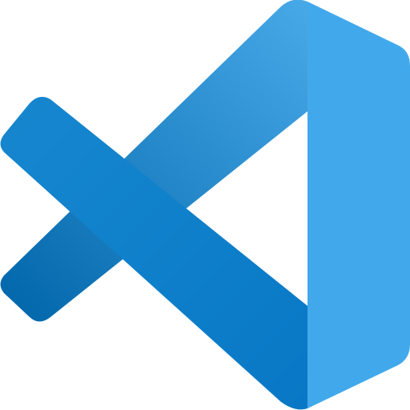

# Setup Guide: Einführung in die Programmierung

Diese Anleitung hilft Ihnen bei der Installation der Programmiersprache  **Python 3.14** und der Entwicklungsumgebung  **Visual Studio Code (VS Code)**.

##  Python 3.14 installieren

Die Installation von Python 3.14 hängt von Ihrem Betriebssystem ab. Wählen Sie Ihr Betriebssystem:  
[ Linux (Ubuntu)](#linux-ubuntu) | [ Windows](#windows) | [ Mac](#mac)

###  Linux (Ubuntu)

#### System aktualisieren

Öffnen Sie ein Terminal (Windows-Taste → "Terminal" eingeben → anklicken) und führen Sie folgende Befehle aus:

```bash
sudo apt update
sudo apt upgrade
```

#### Python 3.14 installieren

Überprüfen Sie Ihre Ubuntu-Version mit folgendem Befehl:

```bash
lsb_release -a | grep Release
```

Falls Sie eine **ältere** Ubuntu-Version als **26.04** (z.B. 22.04 oder 24.04) verwenden, führen Sie die folgenden Befehle aus:

```bash
sudo apt install software-properties-common
sudo add-apt-repository ppa:deadsnakes/ppa
sudo apt update
```

Installieren Sie anschließend Python 3.14:

```bash
sudo apt install python3.14
```

Überprüfen Sie die Installation mit:

```bash
python3.14 --version
```

Es sollte die Ausgabe `Python 3.14.x` erscheinen.

Weiter mit: [Visual Studio Code installieren](#visual-studio-code)

---

###  Windows

Windows bietet die Möglichkeit, ein vollständiges Linux-System über das **Windows Subsystem for Linux (WSL)** zu nutzen. Dadurch können Sie bequem mit denselben Werkzeugen arbeiten wie auf einem Linux-System.

#### WSL installieren

Öffnen Sie PowerShell (Windows-Taste drücken → „PowerShell“ eingeben → anklicken) und führen Sie den folgenden Befehl aus:

```PowerShell
wsl --install -d Ubuntu-24.04
```

Am Ende der Installation werden Sie dazu aufgefordert, einen **Benutzernamen** und ein **Passwort** einzugeben, die Sie für die Anmeldung in Ihrem Ubuntu-System verwenden werden. *(Hinweis: Beim Tippen wird das Passwort nicht angezeigt.)*  

#### Ubuntu aktualisieren

1. Starten Sie Ubuntu (Windows-Taste drücken → „Ubuntu“ eingeben → anklicken).  

2. Aktualisieren Sie das System:

    ```bash
    sudo apt update
    sudo apt upgrade
    ```

3. Installieren Sie Python 3.14 im Ubuntu-Terminal über das deadsnakes-PPA:

    ```bash
    sudo apt install software-properties-common
    sudo add-apt-repository ppa:deadsnakes/ppa
    sudo apt update
    sudo apt install python3.14
    ```

4. Überprüfen Sie die Installation mit:

    ```bash
    python3.14 --version
    ```

    Es sollte die Ausgabe `Python 3.14.x` erscheinen.

Weiter mit: [Visual Studio Code installieren](#visual-studio-code)

---

###  Mac

#### Homebrew installieren und Pakete aktualisieren

Öffnen Sie das Terminal (Spotlight → „Terminal“).
Falls Sie `brew` bereits installiert haben, gehen Sie direkt zu Schritt [Python 3.14 installieren](#mac-python-installieren).

Geben Sie zunächst diesen Befehl ein:

```bash
/bin/bash -c "$(curl -fsSL https://raw.githubusercontent.com/Homebrew/install/HEAD/install.sh)"
```

Es erscheint folgende Ausgabe:

```bash
==> Checking for `sudo` access (which may request your password)...
```

Geben Sie nun **Ihr Passwort** ein (Hinweis: Beim Tippen wird das Passwort nicht angezeigt) und bestätigen Sie mit **Enter**.

Nach kurzer Zeit erscheint die Ausgabe:

```bash
Press RETURN/ENTER to continue or any other key to abort
```

Drücken Sie erneut **Enter**, um die Installation fortzusetzen.

Nachdem die Installation abgeschlossen ist, integrieren Sie Homebrew in Ihre Shell:

```bash
echo >> ~/.zprofile
echo 'eval "$(/opt/homebrew/bin/brew shellenv)"' >> ~/.zprofile
eval "$(/opt/homebrew/bin/brew shellenv)"
```

<a id="mac-python-installieren"></a>

#### Python 3.14 installieren

Um Python 3.14 zu installieren, führen Sie die folgenden Befehle aus:

```bash
brew update
brew install python@3.14
```

Überprüfen Sie die Installation mit:

```bash
python3.14 --version
```

Es sollte die Ausgabe `Python 3.14.x` erscheinen.

Weiter mit: [Visual Studio Code installieren](#visual-studio-code)

##  Visual Studio Code

Als Entwicklungsumgebung verwenden wir im Rahmen der Vorlesung **Visual Studio Code (VS Code)**.

### Installation von VS Code

1. Öffnen Sie die [Download-Seite von Visual Studio Code](https://code.visualstudio.com/Download).  
2. Laden Sie die passende Version für Ihr Betriebssystem herunter:  
   - **Windows:** Version für *Windows* (auch wenn Sie WSL nutzen)  
   - **Mac:** Version für *macOS*
   - **Linux (Ubuntu):** `.deb`-Paket für *Ubuntu*  
3. Öffnen Sie die heruntergeladene Datei und folgen Sie den Installationsanweisungen.
4. Öffnen Sie Visual Studio Code.  
5. **Nur für Windows-Nutzer:** Klicken Sie unten links auf  und wählen Sie **Connect to WSL** aus.

### Extensions installieren

Klicken Sie in der linken Leiste auf , um Ihre Extensions zu verwalten. Installieren Sie die folgenden Extensions, indem Sie die IDs in das Suchfeld eingeben und auf installieren klicken.

| Erweiterung | ID für die Suche |
| --- | --- |
| Python | `@id:ms-python.python` |
| Flake8 | `@id:ms-python.flake8` |

### Extensions konfigurieren

Klicken Sie unten links auf  und wählen Sie **Settings** aus.

**Nur für Windows-Nutzer:** Wählen Sie in der oberen Zeile `Remote [WSL: Ubuntu-24.04]` aus.

1. Nach **@id:python.defaultInterpreterPath** suchen → auf `python3.14` stellen. Öffnen Sie anschließend die Befehlspalette (**Strg+Umschalt+P**, auf dem Mac **Cmd+Umschalt+P**), führen Sie **Python: Select Interpreter** aus und wählen Sie **Python 3.14** aus. Dies ist auch für bereits geöffnete Arbeitsbereiche erforderlich. Unter Windows wählen Sie den Interpreter innerhalb von WSL aus.
2. Nach **@id:files.autoSave** suchen → auf `afterDelay` stellen.  
3. Nach **@id:python.analysis.typeCheckingMode** suchen → auf `basic` stellen.  
4. Nach **@id:python.analysis.diagnosticSeverityOverrides** suchen → auf *edit in settings.json* klicken und den folgenden Eintrag anpassen:

    ```json
    "python.analysis.diagnosticSeverityOverrides": {
        "reportGeneralTypeIssues": "information"
    }
    ```

5. `settings.json` schließen.  
6. Nach **@id:flake8.args** suchen → auf **Add Item** klicken → `--ignore=E501,E704,E731,W5,C901` hinzufügen.

7. Nach **@id:flake8.severity** suchen → alle Werte auf **Warning** setzen (Auf  klicken → `Warning` auswählen → **OK**).
