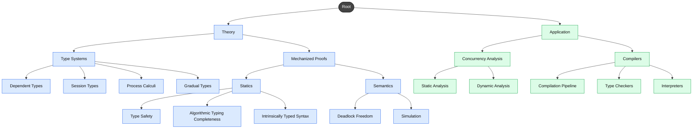

# Projects & Theses

<small>These are the topics we work on. The more specific you are about what you want to do or which topic you want to work in, the better, so please contact [Peter Thiemann](../team/thiemann.md) with your idea.</small>

<noscript>

</noscript>

